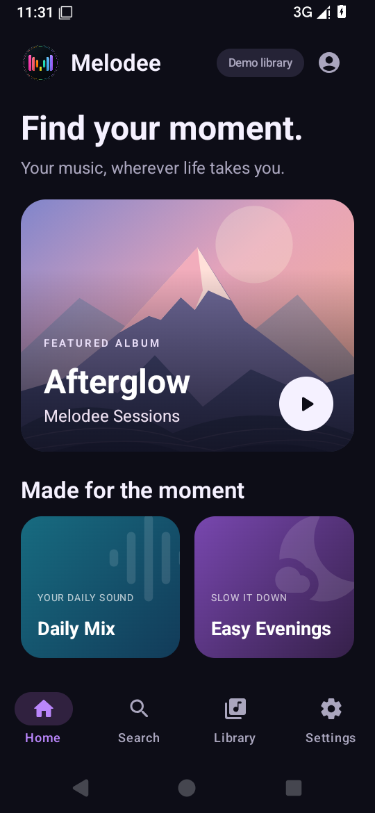
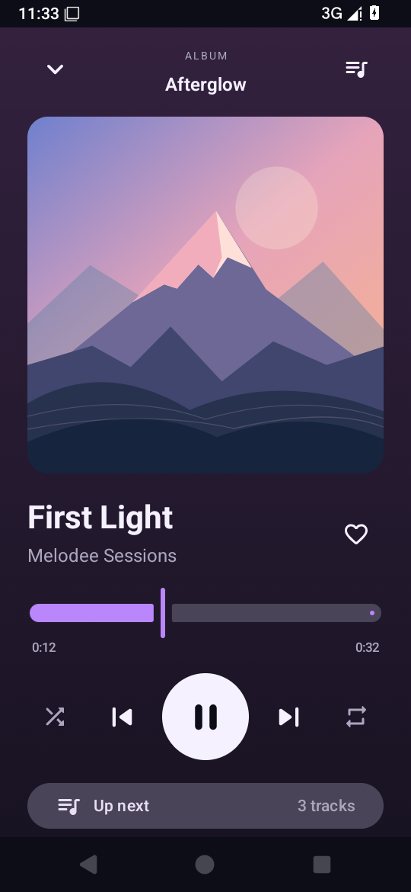
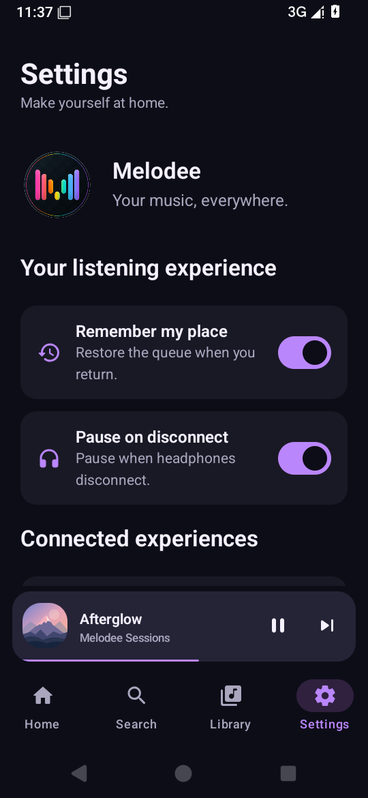

# Melodee for Android


**A greenfield native Android music application with Android Auto built into its architecture.**

The installed app is named **Melodee** and uses the supplied Melodee logo. This starter implements the selected dark, artwork-led visual direction with a real Media3 demo player, Room queue bookmarks and DataStore preferences. It opens in Android Studio at the repository root and runs without a Melodee account.

> **Starter status:** The bundled Demo library contains original preview audio. Live Melodee server login/streaming and the full network-cache executor are upcoming implementation phases. Core prefetch and session-renewal logic are foundations with tests, not a claim that production road-trip reliability is complete. See [VALIDATION.md](VALIDATION.md) for checks actually performed.

## Open and run in Android Studio

1. Extract the ZIP and open the **`melodee-android` directory** containing `settings.gradle.kts`. Do not open only `app/`.
2. Use Android Studio compatible with AGP 8.13.2. Select a compatible Gradle JDK (17 or newer; JDK 21 is the verification baseline).
3. Install **Android SDK Platform 36** and any Build Tools requested by Studio. Let Gradle sync download the pinned dependencies; the first sync requires internet access to the standard Android/Maven/Gradle repositories.
4. In Device Manager, create a phone emulator running **API 29 or newer**; API 36 is the recommended first test.
5. Select the **app** run configuration/module and press **Run**.
6. In **Melodee**, choose a demo album or track and press Play. Test the mini-player, Now Playing, queue, Search and Library. Playback uses real Media3 audio, not an animated mock player.

Android Studio normally creates the machine-specific `local.properties` SDK path. That file must remain untracked. No Firebase project, signing key, private server or password is needed for the demo.

### Command-line build

From the repository root with an Android SDK and compatible JDK configured:

```bash
./gradlew :core:test :app:assembleDebug :app:lintDebug
./gradlew :app:installDebug
```

On Windows, use `gradlew.bat` in place of `./gradlew`. The debug APK is generated under `app/build/outputs/apk/debug/`. If extracting on a filesystem that drops executable permissions, run `chmod +x gradlew` on macOS/Linux.

## What is included

| Area | Included |
|---|---|
| Phone experience | Home, Search, Library, Settings, album/playlist details, Now Playing and queue |
| Audio | Service-owned ExoPlayer, shared session, original previews and Room queue/position/shuffle bookmarks |
| Android Auto foundation | MediaLibraryService, demo browsing/search, track-to-album expansion and local artwork provider |
| Core logic | Context-aware prefetch planning, stable cache identity, coordinated token renewal contracts and tests |
| Preferences | DataStore-backed demo favorites and playback preferences |
| Product documentation | PRD, SPEC, phased IMPLEMENTATION plan, nine ADRs, UX/design rules and coding-agent instructions |
| Design references | Exact supplied logo and selected concept image, with superseded mockup text documented |
| Build | Gradle wrapper, version catalog and reproducible native project structure |

The demo media is a development fixture. The application has no user-managed download feature or offline library. A production streaming cache will remain temporary, bounded and account-scoped.

### Actual starter screens

These are screenshots of the running Android application, separate from the concept reference.

| Home | Now Playing | Settings |
|---|---|---|
|  |  |  |

## Product foundations

1. **Streaming-only consumption** — temporary playback caching, no downloadable music collection.
2. **Context-aware prefetch** — target the remaining album; use a bounded rolling window for large playlists.
3. **Transparent authentication** — shared proactive renewal outside the UI, with concurrency and rotation failures handled explicitly.

The phone, car and Android system controls operate one service-owned player and queue. There is no Car bottom tab. Android Auto controls how its host surface appears and when media is selected/resumed.

## Repository map

```text
app/                  Android application, Compose UI, Media3 service and demo catalog
core/                 Pure Kotlin prefetch/auth foundations and tests
gradle/               Wrapper and pinned dependency catalog
design/branding/      Supplied Melodee logo
design/reference/     Selected mockup and supersession notes
docs/adr/             Architecture decision records
docs/design/          Design system and screen behavior
PRD.md                Product requirements and acceptance scenarios
SPEC.md               Technical architecture and contracts
IMPLEMENTATION.md     Starter boundary and phased delivery plan
CODING_AGENT_PROMPT.md Instructions for the next coordinated implementation
AGENTS.md             Repository collaboration rules
VALIDATION.md         Actual checks, evidence and remaining validation
```

### Important source entry points

- `app/src/main/java/org/melodee/android/playback/PlaybackService.kt` — sole player/session owner, demo browser callbacks and bookmark restoration.
- `app/src/main/java/org/melodee/android/playback/PlayerViewModel.kt` — phone MediaController and UI state.
- `app/src/main/java/org/melodee/android/data/DemoCatalog.kt` — explicit local demo catalog.
- `app/src/main/java/org/melodee/android/data/PlaybackDatabase.kt` — Room bookmark schema/DAO.
- `app/src/main/java/org/melodee/android/data/UserPreferences.kt` — DataStore preferences and demo favorites.
- `app/src/main/java/org/melodee/android/artwork/ArtworkProvider.kt` — allowlisted local artwork access.
- `core/src/main/kotlin/org/melodee/core/cache/PrefetchPlanner.kt` — pure cache policy, not network execution.
- `core/src/main/kotlin/org/melodee/core/auth/SessionCoordinator.kt` — shared renewal and uncertainty model.

Six original 32-second Ogg previews let you test actual transitions. They are intentionally short fixtures, not a demonstration that a full remote album is cached.

## Android Auto development

The app uses a media-library service, so Android Auto consumes browsable/playable content and the same media session as the phone. The starter browse roots are Home, Albums and Playlists; the final four-root hierarchy remains planned. The car mockup is a conceptual reference, not a custom Compose screen projected into a vehicle.

After phone playback is verified, follow Google's [Desktop Head Unit setup](https://developer.android.com/training/cars/testing/dhu) with a supported Android Auto test environment. Debug/sideload discovery can require Android Auto developer configuration. Validate browse, playback, service cold start, queue, search, focus and background auth on supported real hardware before release. A phone emulator run alone is not Android Auto qualification.

## Before connecting a real server

Follow Phase 1 in [IMPLEMENTATION.md](IMPLEMENTATION.md). Pin the exact native Melodee API revision and audit auth rotation, catalog schemas, signed stream URLs and range responses. Then implement the live repository and encrypted credential store. Do not paste production credentials into source, Gradle properties or issue reports.

## Stack and compatibility

Kotlin • Compose/Material 3 • Navigation Compose • Media3 • coroutines/Flow • manual dependency injection. The live integration target adds Retrofit/OkHttp/kotlinx.serialization as needed. The native project contains persistence dependencies where used. Exact versions live in `gradle/libs.versions.toml`; the chosen baseline is deliberately pinned rather than dynamically “latest.”

`org.melodee.android` is the starter application ID; confirm namespace ownership and distribution policy before publication. Minimum API 29 is a starter decision recorded in [ADR-0007](docs/adr/0007-build-and-compatibility.md).

The default build uses a 2 GiB Gradle heap, two workers and in-process Kotlin compilation
to keep Android Studio and an emulator usable alongside it. Override these locally
if your workstation and measurements justify a larger build budget.

## Design references and asset notes

The concept image contains superseded names and offline/download copy. Current PRD/ADRs take precedence; see [reference notes](design/reference/README.md). Preserve the look while implementing **Melodee**, streaming-only behavior and host-controlled Android Auto connection.

[THIRD_PARTY_NOTICES.md](THIRD_PARTY_NOTICES.md) records bundled tooling and asset provenance. The project license remains an owner decision.
