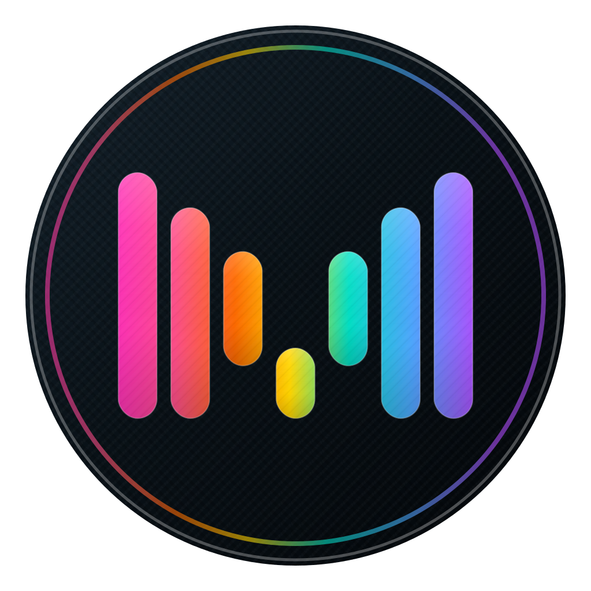

# Melodee for Android



**A greenfield native Android music application with Android Auto built into its architecture.**

The installed app is named **Melodee** and uses the supplied Melodee logo. It implements the selected dark, artwork-led visual direction with one service-owned Media3 player, Android Auto, live native API integration, secure session storage and a bounded temporary streaming cache.

> **Authentication is mandatory.** The app has no offline catalog or in-app demo library. On launch it checks for a saved session and otherwise presents the Melodee sign-in screen. Once authenticated, every browsing screen uses the connected server's catalog; if the server has no content, the app shows an empty state rather than mock data.
>
> **Status:** Username/password authentication, live catalog/search/playlists, signed streaming, account-scoped queue persistence, bounded prefetch and physical-device playback are implemented and verified against the supplied production instance. Android Auto DHU/vehicle testing, refresh-rotation fault injection, dead-zone endurance and release signing remain outstanding. See [VALIDATION.md](VALIDATION.md).

## Open and run in Android Studio

1. Extract the ZIP and open the **`melodee-android` directory** containing `settings.gradle.kts`. Do not open only `app/`.
2. Use Android Studio **Rabbit 2 (2026.2.2) or newer**, the minimum release that supports AGP 9.5. Install and select **JDK 21** for Gradle; the build requires it. Gradle **9.6.1** is supplied by the checked-in wrapper.
3. Install **Android SDK Platform 36** and Build Tools **36.0.0**. Let Gradle sync download the pinned dependencies; the first sync requires internet access to the standard Android/Maven/Gradle repositories.
4. In Device Manager, create a phone emulator running **API 29 or newer**; API 36 is the recommended first test.
5. Select the **app** run configuration/module and press **Run**.
6. On first launch, **Melodee** presents its required sign-in screen. Enter your server's HTTPS origin, username and password, then connect. The app renders the live catalog; there is no demo/offline fallback. Large libraries are browsed with server-side pages (50/100 items) and explicit “Show more” controls rather than fetching the whole catalog. Never commit real server credentials. A **Continue with Google** placeholder is visible while Google OAuth/server setup is pending; it explains the status and does not fake a sign-in.
7. After sign-in, test the mini-player, Now Playing, queue, Search, Library, artists and albums. Playback uses real Media3 audio from the server, not an animated mock player. The app has no user-managed download or offline-library feature.

Android Studio normally creates the machine-specific `local.properties` SDK path. That file must remain untracked. No Firebase project or signing key is needed; a Melodee account and server are required.

### Command-line build

From the repository root with an Android SDK and compatible JDK configured:

```bash
./gradlew :core:test :app:assembleDebug :app:lintDebug
./gradlew :app:installDebug
```

On Windows, use `gradlew.bat` in place of `./gradlew`. The debug APK is generated under `app/build/outputs/apk/debug/`. If extracting on a filesystem that drops executable permissions, run `chmod +x gradlew` on macOS/Linux.

## What is included

| Area | Included |
|---|---|
| Phone experience | Home, Search, Library, Settings, artist/album/playlist details, Now Playing, queue, live sign-in and like/unlike hearts for tracks, albums and artists |
| Audio | One service-owned ExoPlayer, shared MediaLibrarySession, live signed streaming, bounded temporary playback buffer and queue/position/shuffle restoration |
| Authentication | Keystore-backed AES-GCM session record, proactive/single-flight renewal, rotation-ambiguity handling and account cleanup |
| Android Auto | Live MediaLibraryService hierarchy (`Home`, `Library`, `Playlists`, `Favorites`), search, album expansion and one shared queue; DHU/vehicle qualification pending |
| Core logic | Context-aware prefetch planner/executor, stable cache identity and coordinated token renewal with tests |
| Preferences | DataStore-backed playback preferences, account metadata and live favorites |
| Product documentation | PRD, SPEC, phased IMPLEMENTATION plan, thirteen ADRs, UX/design rules, captured API contract/fixtures and coding-agent instructions |
| Design references | Exact supplied logo and selected concept image, with superseded mockup text documented |
| Build | Gradle wrapper, version catalog and reproducible native project structure |

The application has no user-managed download feature or offline library. The streaming cache is temporary, bounded and account-scoped; it is not a browserable offline collection. Bundled audio remains an automated-test fixture and is never presented as an app library.

## Product foundations

1. **Streaming-only consumption** — temporary playback caching, no downloadable music collection.
2. **Context-aware prefetch** — target the remaining album; use a bounded rolling window for large playlists.
3. **Transparent authentication** — shared proactive renewal outside the UI, with concurrency and rotation failures handled explicitly.

The phone, car and Android system controls operate one service-owned player and queue. There is no Car bottom tab. Android Auto controls how its host surface appears and when media is selected/resumed.

## Repository map

```text
app/                  Android application, Compose UI, Media3 service and live catalog adapters
core/                 Pure Kotlin prefetch/auth foundations and tests
gradle/               Wrapper and pinned dependency catalog
design/branding/      Supplied Melodee logo
design/reference/     Selected mockup and supersession notes
docs/adr/             Architecture decision records
docs/api/             OpenAPI reference, implementation contract, provenance and sanitised fixtures
docs/design/          Design system and screen behavior
PRD.md                Product requirements and acceptance scenarios
SPEC.md               Technical architecture and contracts
IMPLEMENTATION.md     Authenticated implementation status and phased delivery plan
CODING_AGENT_PROMPT.md Instructions for the next coordinated implementation
AGENTS.md             Repository collaboration rules
VALIDATION.md         Actual checks, evidence and remaining validation
```

### Important source entry points

- `app/src/main/java/org/melodee/android/playback/PlaybackService.kt` — sole player/session owner, live browse/search callbacks and queue restoration.
- `app/src/main/java/org/melodee/android/playback/PlayerViewModel.kt` — phone MediaController, library state and search/detail loading.
- `app/src/main/java/org/melodee/android/catalog/LiveMusicCatalog.kt` — authenticated catalog and Android Auto hierarchy.
- `app/src/main/java/org/melodee/android/live/auth/LiveSessionManager.kt` — shared account/session boundary.
- `app/src/main/java/org/melodee/android/live/auth/KeystoreSessionStore.kt` — encrypted atomic credential record.
- `app/src/main/java/org/melodee/android/live/cache/AudioCache.kt` — bounded cache and fresh signed-URL resolution.
- `app/src/main/java/org/melodee/android/live/prefetch/PrefetchExecutor.kt` — bounded prefetch execution.
- `app/src/main/java/org/melodee/android/data/PlaybackDatabase.kt` — account-scoped metadata/queue tables and legacy migration.
- `core/src/main/kotlin/org/melodee/core/cache/PrefetchPlanner.kt` — pure cache policy, not network execution.
- `core/src/main/kotlin/org/melodee/core/auth/SessionCoordinator.kt` — shared renewal and uncertainty model.

The bundled 32-second Ogg previews are used by automated transport/service tests. They are not an in-app music library and are not shown to signed-in users.

## Android Auto development

The app uses a media-library service, so Android Auto consumes browsable/playable content and the same media session as the phone. The live roots are Home, Library, Playlists and Favorites. The car mockup is a conceptual reference, not a custom Compose screen projected into a vehicle.

After phone playback is verified, follow Google's [Desktop Head Unit setup](https://developer.android.com/training/cars/testing/dhu) with a supported Android Auto test environment. Debug/sideload discovery can require Android Auto developer configuration. Validate browse, playback, service cold start, queue, search, focus and background auth on supported real hardware before release. A phone emulator run alone is not Android Auto qualification.

## Before connecting a real server

The local client and credential store are implemented. Before using a real deployment, follow Phase 1 in [IMPLEMENTATION.md](IMPLEMENTATION.md): pin the exact native Melodee API revision and audit auth rotation, catalog schemas, signed stream URLs and range responses. Do not paste production credentials into source, Gradle properties or issue reports.

The captured reference is [docs/api/openapi-v1.json](docs/api/openapi-v1.json), the implementation contract is [docs/api/CONTRACT.md](docs/api/CONTRACT.md), and provenance/known gaps are in [docs/api/README.md](docs/api/README.md). The upstream OpenAPI is known-incomplete and is not an approved live contract. Live refresh-rotation recovery, IP-bound URL expiry and range behaviour remain open server-audit items.

For a controlled production username/password check, put credentials only in local environment variables and run:

```bash
MELODEE_BASE_URL=https://music.example.com \
MELODEE_USERNAME=test-user \
MELODEE_PASSWORD='...' \
python3 scripts/melodee_prod_smoke.py
```

The script tests readiness, login, `/user/me`, albums, album songs and a stream HEAD/range read. It prints no tokens or signed URLs.

## Stack and compatibility

Kotlin • Compose/Material 3 • Navigation Compose • Media3 • OkHttp • kotlinx.serialization • Coil • Room • DataStore • coroutines/Flow • manual dependency injection. The client uses a small typed OkHttp layer rather than Retrofit; the native project contains persistence and image dependencies where used. Exact versions live in `gradle/libs.versions.toml`; the chosen baseline is deliberately pinned rather than dynamically “latest.”

The build baseline is AGP 9.5.3 with AGP built-in Kotlin, Gradle 9.6.1, Kotlin 2.4.21, KSP 2.3.14, JDK 21 and compile/target SDK 36. The build scripts use Gradle Kotlin DSL and the public `android` DSL without legacy compatibility opt-outs. See [ADR-0010](docs/adr/0010-modern-build-toolchain.md).

`org.melodee.android` is the application ID; confirm namespace ownership and distribution policy before publication. Minimum API 29 is a starter decision recorded in [ADR-0007](docs/adr/0007-build-and-compatibility.md) and retained by ADR-0010.

The default build uses a 2 GiB Gradle heap, two workers and in-process Kotlin compilation
to keep Android Studio and an emulator usable alongside it. Override these locally
if your workstation and measurements justify a larger build budget.

## Design references and asset notes

The concept image contains superseded names and offline/download copy. Current PRD/ADRs take precedence; see [reference notes](design/reference/README.md). Preserve the look while implementing **Melodee**, streaming-only behavior and host-controlled Android Auto connection.

[THIRD_PARTY_NOTICES.md](THIRD_PARTY_NOTICES.md) records bundled tooling and asset provenance. The project license remains an owner decision.
