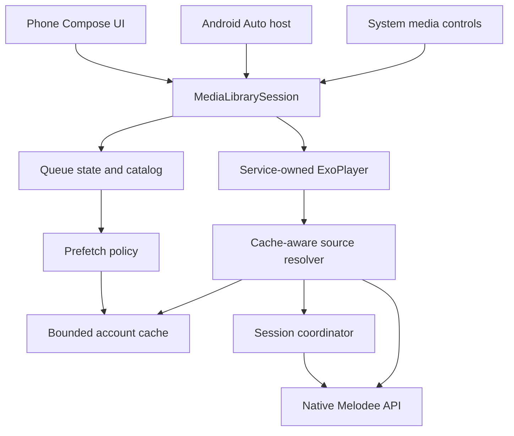

# Melodee Android — Technical Specification

**Version:** 0.1 • **Date:** 2026-11-26  
**Requirements:** [PRD.md](PRD.md) • **Delivery plan:** [IMPLEMENTATION.md](IMPLEMENTATION.md)  
**Decision history:** [ADRs](docs/adr/README.md)

## 1. Delivery boundary

This repository is a runnable, greenfield starter for **Melodee**. Its Android application is a real native program with Compose UI, a Media3 playback service and original local demo previews. The preview catalog lets Android Studio users evaluate the product and media-session boundary without credentials or a private server. It is explicitly identified as a demo.

The full production architecture below is a target specification. A Kotlin policy or coordinator with unit tests is not equivalent to an integrated, qualified streaming subsystem. Live Melodee HTTP contracts, secure credential persistence, account-scoped live queue restoration, network prefetch execution and real-car endurance must be completed in the documented implementation phases. The implementation status table is maintained in [IMPLEMENTATION.md](IMPLEMENTATION.md); measured results belong in [VALIDATION.md](VALIDATION.md).

## 2. Build and project identity

| Item | Starter selection |
|---|---|
| Installed/application label | **Melodee** |
| Application ID and namespace | `org.melodee.android` — confirm ownership before publication |
| Minimum Android API | 29 / Android 10; compatibility decision subject to review |
| Compile/target API | 36 |
| JDK | 21 (required to run Gradle and compile; Java/Kotlin bytecode target 17) |
| Gradle | 9.6.1 with checked-in wrapper and official distribution checksum |
| Android Gradle Plugin | 9.5.3 with built-in Kotlin and the public `android` DSL |
| Kotlin | 2.4.21 (Kotlin Gradle Plugin); KSP 2.3.14 |
| Compose BOM | 2025.10.01 |
| Media3 | 1.8.0 |
| Navigation | Navigation Compose 2.9.5 |

These are a deliberately pinned, coherent compatibility baseline, **not a claim to be the latest versions**. Authoritative dependency values live in `gradle/libs.versions.toml`. Upgrade as a reviewed change with compatibility/build evidence. Navigation 3 remains a future evaluation; it is not silently mixed with Navigation Compose in the starter. See ADR-0004, the superseded ADR-0007 and the current ADR-0010.

### Modules

- `:app`: Android application, phone UI, Android Media3 adapters, service and catalog/demo integration.
- `:core`: Android-independent Kotlin policies/contracts for prefetch and authentication. Keep transport, UI, Android context and credentials out of pure decision logic.

Start with these two modules. Add modules only for a demonstrable ownership, build-isolation or reusable boundary. Feature packages do not require separate Gradle modules. Constructors declare dependencies; one application container owns long-lived service objects.

## 3. Architecture

Only the service owns the player. The phone uses a MediaController; it does not construct another ExoPlayer or maintain a separate authoritative queue. Android Auto speaks to the same session and catalog. Media3 provides the service/session bridge; it does not make app-specific authentication, queue persistence or cache policy automatic.

The diagram describes production responsibilities, not a mandate for one class per box. The starter's demo repository and resource resolver implement only the local-media path.

## 4. Phone application and visual system

Use Jetpack Compose with Material 3 primitives and a custom theme. The starter renders local vector artwork directly; Coil remains available for the future network-artwork adapter and does not supply a live image pipeline yet. Follow [UX-SPEC.md](docs/design/UX-SPEC.md) and [DESIGN-SYSTEM.md](docs/design/DESIGN-SYSTEM.md). Primary navigation remains Home / Search / Library / Settings. Mini-player state is derived from the controller. Now Playing and Queue share the same transport state.

The supplied circular logo is the brand source of truth. Preserve its colors and proportions. Android adaptive-icon layers may provide safe-area padding and a background; do not redraw the mark or replace it with a generated approximation. The installed label has no Beta, Player, Android or StreamBeat suffix. In-app demo disclosure communicates the starter's status.

The starter persists preferences and demo favorites through DataStore; extend this typed settings boundary for live playback policy. Save transient navigation state with platform-supported state mechanisms. A screen may use view models for its presentation state, but must not own an authentication refresh timer or player lifecycle.

## 5. Domain identities and queue

### Stable identity

A production playable reference includes server identity, account identity, catalog track ID, representation and revision if available. A queue entry additionally has a unique entry ID, because the same track may appear multiple times. Never use a signed URL as a database primary key, queue identity or cache identity.

A cache key can be derived from a collision-resistant encoding of:

`serverIdentity | accountIdentity | trackId | representation | revision`

The canonical server identity should survive equivalent trailing slash normalization but must not casually collapse distinct servers, users or ports. Do not include credentials, secret query parameters or expiring signatures in keys or logs. If the server cannot provide an immutable media revision, define a bounded revalidation policy before reusing existing bytes after catalog changes.

### Queue snapshot

Persist queue-entry identities, playback context, actual order, shuffle order/seed where meaningful, repeat mode, index and last useful playback position. Preserve album-disc ordering and duplicate track occurrences. Changes increment a queue generation; asynchronous fetches and restoration must validate the generation before applying results.

An album request supplies all known tracks in order, selects the requested start index and starts promptly. Large playlists may use repository paging but the player and prefetch planner must know a sufficient authoritative upcoming window. API pagination must not introduce a network dependency at the boundary to an already cached next track.

### Intent and restoration

User pause/stop wins over automatic recovery. Record intended play state separately from temporary buffering. On process recreation restore state as permitted by an explicit user/host request and current auth state. Service discovery or a browse connection alone must not start audible playback. Resume does not mean blindly calling `play()` during application startup.

## 6. Cache and prefetch subsystem

### Storage layers

1. In-memory playback buffer managed by Media3.
2. Temporary application-private disk cache for streamed audio.
3. Metadata/artwork cache to render and transition without needless network calls.
4. Durable queue/settings records, which are not downloaded music.

`SimpleCache` and `CacheDataSource` are candidate disk plumbing. `CacheWriter` or compatible preloading APIs can fill planned ranges. Choose one execution strategy in an integration spike; do not fetch the same item through two competing preload mechanisms. A prepare/preload operation is not proof that an entire track is durably cached. Track exact cached byte ranges and completeness.

Do not add Media3 DownloadManager/DownloadService or an offline collection schema. A bounded disposable cache may exist across process restarts but is never presented as a promised persistent download. Android or the application may evict it.

### Planner contract

Inputs: queue generation and context, actual ordered entries, current index/position, durations and estimated sizes when known, existing cached ranges/completeness, byte budget, network/data policy and active-buffer health.

Outputs: an ordered fetch plan and retention priorities. Pure planning logic performs no network I/O, changes no credentials and claims no completed fetch. The starter provides `org.melodee.core.cache.PrefetchPlanner` as this boundary.

| Context | Policy |
|---|---|
| Album | Current track first; remaining album in actual playback order while resources permit. |
| Playlist or long manual queue | Three already-cached previous entries, current track, then at least three upcoming tracks plus optional duration coverage. |
| Shuffle | Plan against actual shuffled order, never original catalog order. |
| Radio/discovery | Plan only known upcoming entries; extend when the server provides more. |
| Single track | Fill the current track when feasible; repeat can reuse it. |

### Priority and budgets

The active player's read demand has first priority. Complete immediately needed missing ranges before speculative distant tracks. Use cancellation and a low concurrency ceiling; reduce or stop background work if active buffer falls below a measured threshold. Account for partial files, unknown lengths, large FLAC files and bytes already allocated. The planner uses estimated sizes to bound its candidate plan. The executor must enforce the actual hard byte budget; it cannot exceed it merely because a track-count target has not been met.

Retention protection is a relative priority inside a hard budget, not an absolute promise. A cache evictor must reserve space for the active track and near-future content before protecting a whole album. LRU alone does not express those priorities. Where whole-album caching is infeasible, degrade to nearest-track coverage and record why. Do not fetch previous tracks solely to populate a retention window.

Candidate tuning: 1 GiB audio budget, 20-minute forward target, three tracks behind/ahead, two background fetches and a 24-hour inactive-entry age ceiling. Validate in the target quality/codec matrix. Keep these parameters centralized and testable; do not promise a number of outage minutes from a byte limit.

### Invalidation

Logout/account change increments account generation, cancels reads/prefetch, stops playback as appropriate, clears credential state and removes account audio. In-flight completions must check the generation before committing. Definitive access withdrawal is not a network outage. Normal token rotation and IP changes do not invalidate already valid cached audio bytes.

Temporary loss of connectivity permits continued use of authorized cached media within the established session. A brand-new session requires the chosen authorization policy; possession of old cache entries must not become perpetual offline access.

## 7. Authentication and source authorization

### One coordinator

Every authenticated API caller uses the same session coordinator, including live catalog queries, prefetch, playback source resolution and listening-event submission. The pure core starter exposes `SessionCoordinator`, a token-generation/account-epoch model and a durable refresh-attempt store contract; secure store and HTTP adapters are integration work.

Token state includes an account/session generation, access token, refresh token and trusted expiry information. Use server-provided expiry or validated JWT timing with clock-skew allowance; do not hard-code a 15-minute lifetime into scheduling. Refresh with a configurable margin before useful authenticated work and while active playback/prefetch needs continued authorization. Use an elapsed clock for retry intervals and conservative wall-clock handling for absolute expiry.

### Single-flight semantics

Under a coroutine-compatible synchronization boundary:

1. Read current credentials and account generation.
2. If another request has already installed newer valid credentials, use those.
3. If a refresh is needed, allow one exchange to own the old refresh token.
4. Other consumers await the same in-flight result; a cancelled waiter must not accidentally cancel a refresh needed by others.
5. Persist the complete rotated credential pair atomically, then publish the new generation.
6. Discard success from a superseded/logged-out account generation.

A mutex by itself is insufficient if all waiting callers blindly perform a second refresh after taking it. Recheck the generation inside the protected path. Ordinary 401 recovery is bounded; an endpoint-specific permission failure is not proof that every credential is invalid.

### Failure classification

| Class | Behavior |
|---|---|
| Access expiry | Renew silently; do not pause already authorized cached playback. |
| Known pre-send network failure | Retry with backoff when useful; keep credentials. |
| Server unavailable/rate limited | Backoff, honor retry information and preserve state. |
| Refresh credential definitively revoked | Mark reauthentication required; prevent further protected retrieval. |
| Rotation response lost / uncertain dispatch | Mark ambiguous; do not automatically replay a potentially consumed token. |
| Account switch during operation | Cancel/discard by generation and cleanup old account state. |

Strict refresh rotation creates a distributed transaction: a server may commit rotation while the client loses the response or crashes before persistence. No purely client-side mutex can make that transaction atomic. The live API audit must establish a server-supported idempotency/recovery or narrowly bounded rotation-recovery mechanism. Any such server change requires its own security decision. Never weaken replay checks or invent successful recovery.

### Secure storage

Use Android Keystore-protected encryption for credentials in app-private storage. Keystore holds cryptographic keys, not arbitrary token records. Replace the credential pair atomically; define what happens when a key becomes inaccessible or a restore lacks the original key. Exclude credentials/audio from backup where appropriate. Never retain the account password or log tokens, Authorization headers or signed URLs. A development demo must never pretend to securely store real credentials.

### Signed media URLs

Access tokens authorize API calls; signed stream URLs authorize byte retrieval. These have different expiry and potential binding rules. A stream resolver obtains fresh transport data just before a network open and after classified rejection. Changing Wi-Fi/cellular addresses may require a fresh URL even with a valid access token. Preserve `Range` intent and playback position when retrying.

Fully cached playback must read cache before requiring live URL renewal, under the active-session authorization policy. Cache identity remains stable across URL replacement. Do not generically attach bearer headers to arbitrary artwork/CDN origins or redirects. The live adapter validates allowed origin transitions and URI schemes.

## 8. Melodee API integration contract

Use the native API. Do not infer an OAuth/OIDC flow, HLS endpoint or server queue feature merely because another client library supports it. Audit the exact target server revision and record sanitized request/response fixtures for:

- Server discovery/version and base URL behavior.
- Login, refresh rotation, logout/revocation, expiry, clock skew and error classification.
- Catalog IDs, albums/discs/tracks, playlist order/duplicates, search and favorites.
- Pagination, filtering, nullability and safe mutation semantics.
- Stream URL resolution, expiry, client-address binding and redirects.
- Full and ranged GET, HEAD, response codes, length/type, seeking and cancellation.
- Artwork types/sizes, cache validators and missing-image behavior.
- Listening history/scrobbling and deduplication/idempotency support.

Retrofit + OkHttp + kotlinx.serialization are the planned network stack. Add dependencies when implementing tested adapters, not merely to satisfy an architectural checklist. A shared auth coordinator is authoritative; an OkHttp Authenticator is only an adapter and must not recursively invoke itself, deadlock its dispatcher or retry unsafe mutations without a replay policy.

Direct progressive streaming is the initial path. Evaluate original formats and optional server transcoding from real capabilities. Do not require HLS packaging or a CDN to run a personal Melodee server.

## 9. Android Auto

Media3 `MediaLibraryService` exposes browsable/playable nodes and one session. Android Auto renders its host experience; phone Compose screens are not projected to the head unit. Brand colors/artwork and content hierarchy can influence presentation within host rules. Treat car mockups as UX references, not pixel-perfect custom-layout commitments.

The starter demo exposes Home, Albums and Playlists. Target production root categories are Home, Library, Playlists and Favorites. Bound each level using host hints and grouping. Server pagination remains useful internally, but Android Auto/AAOS browsing does not support relying on `page`/`pageSize` for incremental display. Alphabetical groups and meaningful shortcuts prevent enormous responses. Search supports catalog matching and deterministic playable resolution.

Media3 search callbacks and request metadata handle search-to-play requests. Do not implement legacy `onPlayFromSearch` as if it were a `MediaLibraryService` callback. Unknown IDs return an appropriate library error; arbitrary external URIs must not be played simply because an untrusted controller submitted them.

Use explicit AudioAttributes with automatic focus handling where chosen. Steering-wheel and host controls operate session commands. Audio output volume belongs to platform/vehicle policy. Calls and navigation prompts are validated separately. Car setup preferences are reached from phone Settings and must not imply the app can override host auto-launch/auto-resume policy.

Production qualification includes DHU, real phones, wired/wireless connections, cold service launch, locked-screen renewal, voice queries, error states, missing art, host limits and focus transitions. Native Android Automotive OS requires a separate packaging/distribution review.

## 10. Data, lifecycle and diagnostics

The starter uses Room for demo queue bookmarks, position, repeat and persisted shuffle traversal, and DataStore for preferences/favorites. Extend Room with account-scoped live queue snapshots, catalog metadata, recent items and a bounded retry outbox where appropriate. A single in-memory object is not durable persistence. WorkManager is for deferrable synchronization/cleanup; do not depend on periodic jobs for a three-minute token-renewal deadline or active playback continuity.

Register `ConnectivityManager` callbacks for state changes but treat connectivity reports as hints: a network can be present while the server is unreachable. Measure request results and buffer health. Do not equate a signal-strength icon with guaranteed throughput.

Use local structured diagnostics with event categories, correlation IDs, elapsed timings, queue/account generation identifiers that cannot reveal secrets, retry counts and failure classification. Redact before storage. Sanitized export is user-triggered. Diagnostic logs should not include song titles unless the user explicitly enables that detail, and must never include credentials or signed media URLs.

## 11. Testing boundaries

Pure-core tests prove deterministic planning and auth coordination. HTTP contract tests prove endpoint semantics. Android instrumentation proves actual service/controller behavior. DHU proves one host integration. Real-device endurance and fault injection prove the targeted listening journey. None substitutes for the others.

Tests should exercise duplicate queue items, unknown durations/sizes, huge tracks, exact budget boundaries, shuffle edits, cancellation, account changes, concurrent renewals, old-token 401 bursts, storage failures, lost rotation responses and paused intent during recovery. Keep implementation reports explicit about tests not executed due to environment constraints.

## References

- [Media3 background playback](https://developer.android.com/media/media3/session/background-playback)
- [MediaLibraryService](https://developer.android.com/media/media3/session/serve-content)
- [Car browse hierarchy](https://developer.android.com/training/cars/media/create-media-browser/content-hierarchy)
- [MediaSession.Callback](https://developer.android.com/reference/androidx/media3/session/MediaSession.Callback)
- [Media3 preload manager](https://developer.android.com/media/media3/exoplayer/preloading-media/preloadmanager)
- [SimpleCache](https://developer.android.com/reference/androidx/media3/datasource/cache/SimpleCache)
- [CacheDataSource](https://developer.android.com/reference/androidx/media3/datasource/cache/CacheDataSource)
- [Android Keystore](https://developer.android.com/privacy-and-security/keystore)
- [Android network state](https://developer.android.com/develop/connectivity/network-ops/reading-network-state)
- [Melodee native API audit target](https://github.com/melodee-project/melodee-rs/blob/main/docs/src/content/docs/api/melodee-api.md)
